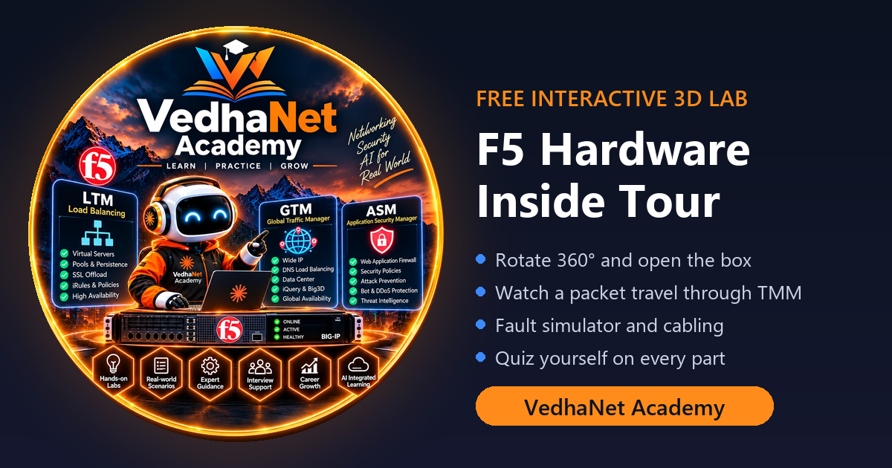

# F5 Hardware 3D Tour

**Open an F5 BIG-IP box in 3D and learn what every part does.**
A free, interactive teaching tool by [VedhaNet Academy](https://www.vedhanetacademy.com).

**Live site:** https://hardware.vedhanetacademy.com



## What you can do

| Feature | What it teaches |
|---|---|
| **Rotate 360° and open the box** | Unscrew the cover screws, lift the lid and see the board, CPU, RAM, PSUs and fans. |
| **Tap any part** | It lifts out of the chassis and explains *what it is*, *why F5 needs it* and *how it works in F5*. |
| **Packet flow** | Follow one connection: port → switch → HSB/DAG → TMM → crypto → shared table → server, and back. |
| **Fault simulator** | PSU failure, fan failure, link down, TMM restart and HA failover — watch the LEDs, LCD and peer react, then fix it. |
| **Cabling** | Core switch, server switch, HA peer, management, console and A + B power — with example VLANs and IPs. |
| **Quiz** | 10 random parts with labels hidden — find each one on the model and get a score. |

Platforms covered: **rSeries** (r5000 / r10000 class), **iSeries** (i15000 class) and the **VELOS CX410** chassis with SX410 controllers and BX110 blades.

## Run it locally

No build step — it is plain HTML, CSS and JavaScript (3D rendering uses [three.js](https://threejs.org) from a CDN, so an internet connection is needed).

```bash
python -m http.server 8765
```

Then open http://localhost:8765 in your browser.

## Project structure

```
index.html                     Home page
f5-hardware-inside-tour.html   The 3D tour
assets/brand.js                Website + WhatsApp links used by every button
assets/                        Logo, favicon and share-preview image
netlify.toml                   Netlify publish settings
```

To change the "Book free demo" or WhatsApp links, edit `assets/brand.js`.

## Deploy

Hosted on Netlify. Every push to `main` deploys automatically to https://hardware.vedhanetacademy.com.

## Disclaimer

Independent teaching tool — not affiliated with or endorsed by F5, Inc. F5, BIG-IP, rSeries, iSeries and VELOS are trademarks of F5, Inc. The 3D model is a simplified teaching illustration, not an exact replica; port counts, LED behaviour and specifications vary by model and software version. Always confirm against F5's official platform guides.

## Learn F5 with VedhaNet Academy

Live F5 BIG-IP training — LTM, GTM, ASM / Advanced WAF, hands-on labs and interview support.

- Website: https://www.vedhanetacademy.com
- WhatsApp: +91 93547 18526

© VedhaNet Academy · Learn · Practice · Grow
